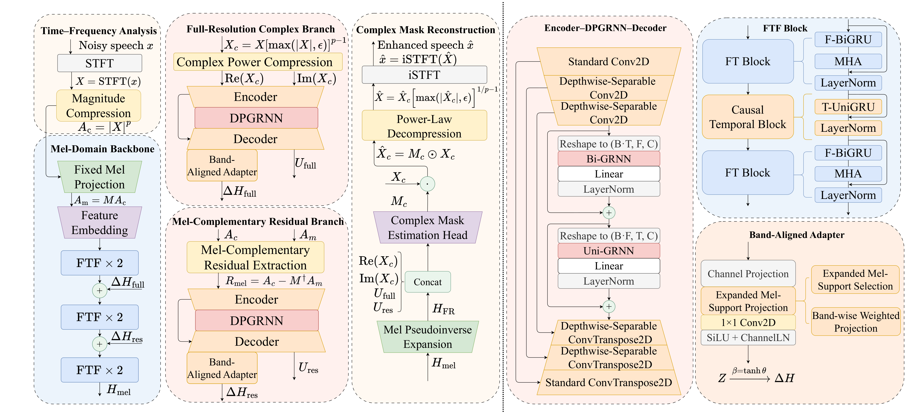

# MelFR-FTF

**Complementary Mel and Full-Resolution Modeling for Lightweight Causal Speech Enhancement**

> **Status:** Submitted to ICASSP 2027. If accepted, we plan to release the core MelFR-FTF block implementations, configuration files, and pretrained inference models, including an ONNX export.

MelFR-FTF is a lightweight single-channel speech enhancement model. This repository provides the project overview and evaluation results.

## Architecture

## Results

MelFR-FTF has **69.26K trainable parameters** and **399M neural MACs/s**, with causal neural processing and **16-ms centered-STFT look-ahead**. The tables below report the submitted manuscript results. Bold numerical values indicate the best value in each column, including ties; lower parameters, MACs/s, and look-ahead are better, while higher quality scores are better.

### VoiceBank+DEMAND: baseline comparison

Evaluation uses the standard 16-kHz, 824-utterance test set. STOI is reported in percent.

| Model | Params (M) | MACs/s (G) | Look-ahead (ms) | PESQ | CSIG | CBAK | COVL | STOI (%) |
| :--- | ---: | ---: | :---: | ---: | ---: | ---: | ---: | ---: |
| FTF-Net | 0.140 | 0.300 | **0** | 2.99 | 4.33 | 3.61 | 3.71 | **95.0** |
| MGT-DSN | 0.140 | 0.220 | **0** | 2.98 | 4.31 | 3.61 | 3.70 | 94.0 |
| LCT-GAN+PCS | 0.140 | 0.350 | 32 | 3.16 | 4.35 | 3.45 | 3.81 | 94.0 |
| DeepFilterNet3 | 2.135 | 0.331 | 20 | 3.17 | 4.34 | 3.61 | 3.77 | 94.4 |
| MANNER | 24.069 | 8.618 | Non-causal | **3.21** | **4.53** | 3.65 | **3.91** | **95.0** |
| GTCRN† | **0.024** | **0.033** | 16 | 2.87 | 4.11 | 3.47 | 3.50 | 94.0 |
| FastEnhancer-B | 0.092 | 0.262 | 16 | 3.14 | 4.25 | 3.63 | 3.72 | 94.5 |
| FastEnhancer-S | 0.195 | 0.664 | 16 | **3.21** | 4.25 | **3.66** | 3.76 | 94.8 |
| **MelFR-FTF (ours)** | 0.069 | 0.399 | 16 | 3.18 | 4.29 | 3.63 | 3.76 | 94.5 |

GTCRN and FastEnhancer-B/S use our common evaluator; other quality values follow the respective cited works in the manuscript. DeepFilterNet3 and MANNER complexities are re-profiled under the same neural-only convention; remaining baseline complexities follow the cited sources. Common-evaluator rows use 16-ms centered-STFT inference. “Non-causal” denotes unrestricted full-sequence future context. †GTCRN has 23.67K trainable parameters (48.24K with its ERB mapping).

The headline MelFR-FTF result uses the canonical run. Across three independently trained runs, PESQ is **3.172 ± 0.005** (mean ± sample standard deviation); this is reported separately rather than replacing the headline result.

### DNS: baseline comparison

DNS uses a **separately trained MelFR-FTF model**, trained on DNS-Challenge-3 plus VCTK under the fixed 500-epoch FastEnhancer-aligned recipe and evaluated on 150 synthetic no-reverb pairs. These results do not represent direct transfer from a VoiceBank-trained model. P.808 denotes DNSMOS P.808.

| Model | Params (K) | P.808 | SI-SDR (dB) | PESQ | STOI (%) |
| :--- | ---: | ---: | ---: | ---: | ---: |
| GTCRN† | 24 | 3.85 | 14.8 | 2.26 | 93.4 |
| LiSenNet | 37 | 3.82 | 16.3 | 2.58 | 94.7 |
| FSPEN | 79 | 3.82 | 15.8 | 2.43 | 94.3 |
| BSRNN | 334 | 3.89 | 16.7 | 2.61 | 95.1 |
| FastEnhancer-T | **22** | 3.81 | 15.4 | 2.43 | 94.0 |
| FastEnhancer-B | 92 | 3.92 | 16.7 | 2.69 | 95.3 |
| FastEnhancer-S | 195 | **3.96** | **17.5** | **2.79** | **96.0** |
| **MelFR-FTF (ours)** | 69 | 3.91 | 16.9 | 2.56 | 95.2 |

Baseline values follow the DNS comparison in the manuscript. MelFR-FTF provides a favorable lightweight trade-off, not overall superiority across all metrics.

### VoiceBank+DEMAND: ablations and representation study

All variants below are evaluated on VoiceBank+DEMAND. Three decimal places are retained for PESQ and COVL to show the small differences between configurations.

| Variant | Params (K) | MACs/s (M) | PESQ | COVL | STOI (%) |
| :--- | ---: | ---: | ---: | ---: | ---: |
| w/o Full & Residual | **40.03** | 350 | 3.131 | 3.728 | 94.34 |
| w/o Residual | 60.40 | 388 | 3.139 | 3.724 | 94.47 |
| w/o Full | 48.89 | 361 | 3.103 | 3.696 | 94.31 |
| w/o Intermediate Injection | 62.74 | 398 | 3.127 | 3.714 | 94.48 |
| w/o Final Fusion | 68.97 | 395 | 3.129 | 3.733 | 94.49 |
| 40-Mel | 68.90 | **195** | 3.124 | 3.715 | 94.40 |
| Full-257 counterpart | 57.28 | 2215 | **3.184** | **3.765** | **94.63** |
| **MelFR-FTF (ours)** | 69.26 | 399 | 3.177 | 3.759 | 94.53 |

“Full” denotes the full-resolution complex branch, and “Residual” denotes the Mel-Residual branch. Intermediate injection conditions the Mel backbone; final fusion provides direct branch outputs to the complex mask head. Removing these routes reduces PESQ by 0.050 and 0.048, respectively.

40-Mel changes only Mel resolution. The Full-257 counterpart applies the same six-block contextual backbone to all 257 STFT bins, retaining the complex branch but removing Mel-specific projection/residual machinery. Compared with 80 Mel bands, 40-Mel reduces neural MACs/s from 399M to 195M with a 0.053 PESQ drop; Full-257 requires 5.55× the neural MACs/s for a 0.007 PESQ gain. The 80-band configuration is a favorable operating point, rather than an asserted optimum.

### Additional reported metrics

The project overview also reports the following FastEnhancer-aligned evaluation metrics. These are kept separate from the manuscript's standard VoiceBank quality table; unavailable entries are marked “—”. STOI and eSTOI are reported in percent. SCOREQ is lower-is-better; the other listed quality metrics are higher-is-better.

| Dataset | P.808 | SIG | BAK | OVL | SI-SDR (dB) | PESQ | STOI (%) | eSTOI (%) | SCOREQ |
| :--- | ---: | ---: | ---: | ---: | ---: | ---: | ---: | ---: | ---: |
| VoiceBank+DEMAND | 3.48 | — | — | — | 18.9 | 3.18 | 94.5 | 86.0 | — |
| DNS | 3.91 | 3.39 | 4.11 | 3.16 | 16.9 | 2.56 | 95.2 | 90.1 | 0.442 |

**Complexity convention:** neural MACs/s count convolution, transposed convolution, linear layers, GRU, MHA, and packed projections. STFT/iSTFT, fixed Mel/pseudoinverse transforms, normalization, activation, bias, and elementwise operations are excluded. Units follow the manuscript: K = thousands, M = millions, and G = billions.

## Citation

Citation information will be added after publication.
